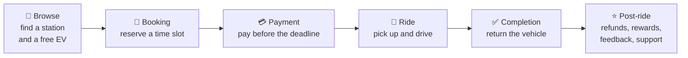
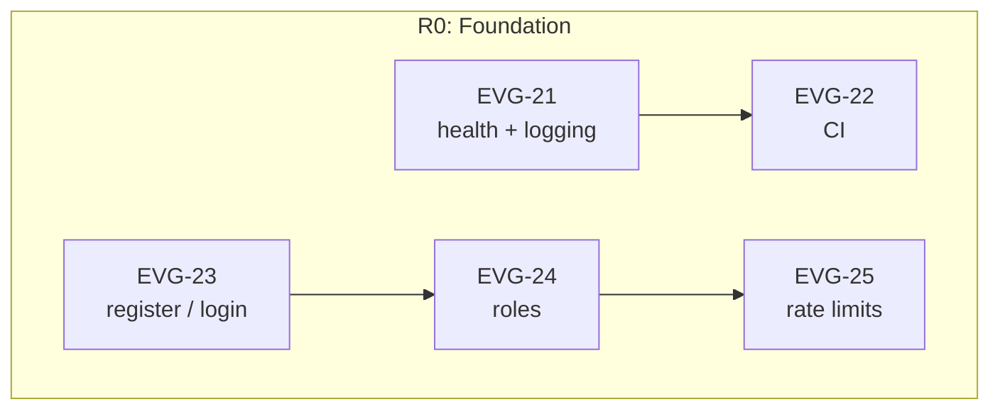
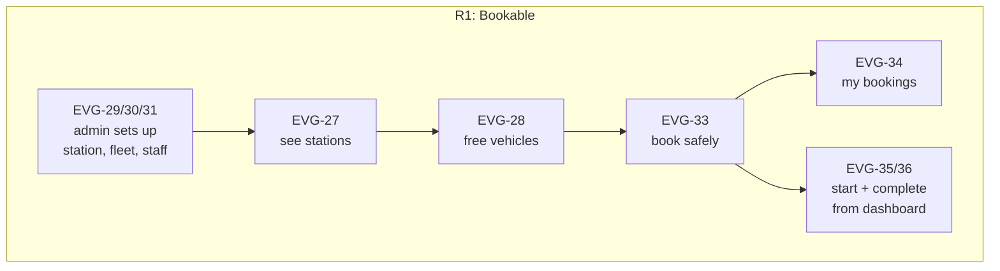
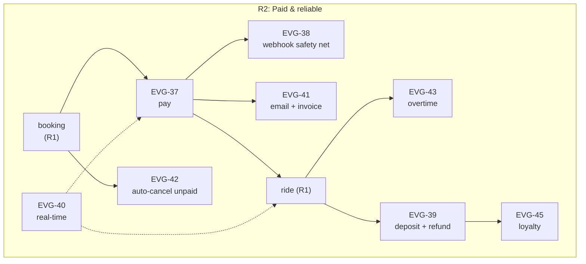
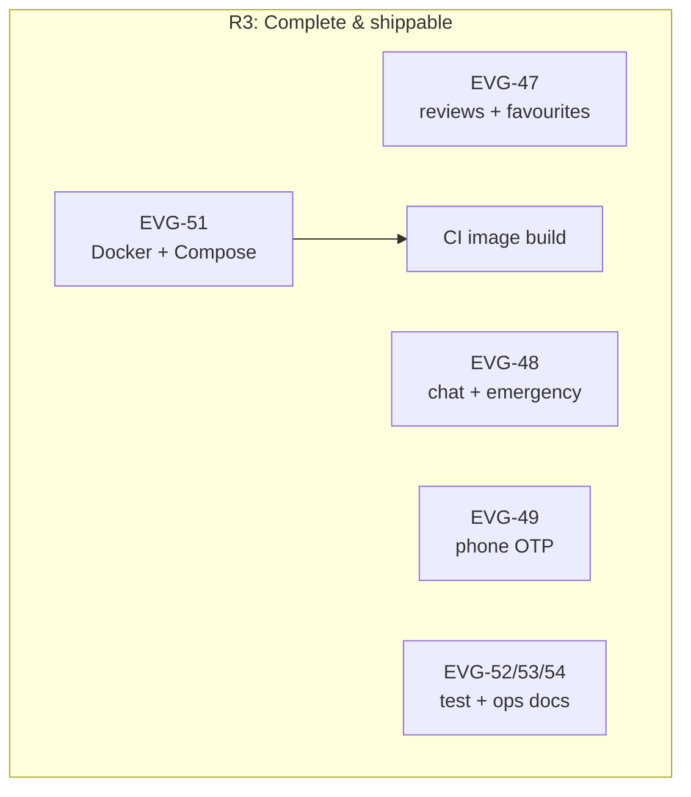

# Story Map — EV-Go

The story map lays the backlog out along the renter's journey (the **backbone**), with the supporting staff and platform work below it. Horizontal **release slices** cut through the map: each slice is the thinnest set of stories that gives a usable product at the end of a sprint.

Story details: [user-stories.md](user-stories.md) · Priorities and points: [product-backlog.md](product-backlog.md)

## 1. Backbone: the renter's journey

Two supporting lanes sit under the backbone. Users never see them, but the journey doesn't work without them:

- **Station & admin operations:** stations, fleet, staff, analytics (Station Master, Super Admin)
- **Platform:** auth, notifications, logging, CI, containers

## 2. The map

Rows are release slices, columns are backbone activities. Each cell lists the user tasks (stories) delivered in that slice. Within a cell, the most important story comes first.

| Slice | 🔎 Browse | 📅 Booking | 💳 Payment | 🚗 Ride | ✅ Completion | ⭐ Post-ride |
|---|---|---|---|---|---|---|
| **R0: Foundation** (Sprint 1) | Sign up / log in *(EVG-23)* | – | – | – | – | – |
| **R1: Bookable** (Sprint 2) | See stations *(EVG-27)* Find a vehicle free for my slot *(EVG-28)* | Book without double-booking *(EVG-33)* View & modify my bookings *(EVG-34)* | – | Station master starts the ride *(EVG-35)* | Station master completes / cancels *(EVG-35)* | My ride analytics *(EVG-34)* |
| **R2: Paid & reliable** (Sprint 3) | – | Unpaid bookings auto-released *(EVG-42)* | Pay with Razorpay *(EVG-37)* Confirmed even if the tab closes *(EVG-38)* Email + PDF invoice *(EVG-41)* | Live updates *(EVG-40)* Overtime billed automatically *(EVG-43)* | Deposit released *(EVG-39)* | Request a refund *(EVG-39)* Earn & redeem points *(EVG-45)* Raise a support ticket *(EVG-46)* |
| **R3: Complete & shippable** (Sprint 4) | Save favourites, read reviews *(EVG-47)* | Verify my phone *(EVG-49)* | – | Chat with station, emergency alert *(EVG-48)* | – | Review the vehicle *(EVG-47)* |

**Supporting lanes**

| Slice | Station & admin operations | Platform |
|---|---|---|
| **R0** (Sprint 1) | – | Health, logging, config *(EVG-21)* CI lint + build *(EVG-22)* Role-based access *(EVG-24)* Rate limiting *(EVG-25)* |
| **R1** (Sprint 2) | Manage stations *(EVG-29)* Manage vehicles *(EVG-30)* Manage station masters *(EVG-31)* Station dashboard *(EVG-36)* | In-app notifications *(EVG-32)* |
| **R2** (Sprint 3) | System analytics *(EVG-44)* Customers & active rides *(EVG-50)* Approve refunds *(EVG-39)* | Payment watchdogs *(EVG-42)* |
| **R3** (Sprint 4) | – | Docker + Compose + CI image build *(EVG-51)* Test strategy *(EVG-52)* CD / cloud / K8s / monitoring plans *(EVG-53)* Architecture + README *(EVG-54)* |

## 3. Release slices

### R0: Foundation (Sprint 1, 2026-10-25)
**Outcome:** a user can register and log in, each role sees only its own area, and every push is linted by CI.
Not yet useful to a renter, but it's the walking skeleton everything else hangs on.

### R1: Bookable (Sprint 2, 2026-10-26)
**Outcome:** the first complete journey. A super admin sets up a station, vehicles and a station master. A user finds a free vehicle and books it. The station master starts and completes the ride.
Payment is skipped in this slice, so bookings stay `paymentStatus: pending`. Starting a ride needs a completed payment, so the start-ride demo in R1 uses a seeded paid booking.

### R2: Paid & reliable (Sprint 3, 2026-10-27)
**Outcome:** a commercially usable product. Every booking is paid through Razorpay or released automatically. Refunds follow the published policy. Staff see changes live. Late returns are billed without anyone stepping in.

### R3: Complete & shippable (Sprint 4, 2026-10-28)
**Outcome:** the full feature set (reviews, favourites, chat, OTP), running with `docker compose up` and built by CI, with test and operations documentation.

## 4. Reading the map

- **The first slice that works end to end is R1.** By the end of Sprint 2 a booking can go through browse → book → ride → complete. Sprint 2's demo should walk exactly that path.
- **Payment arrives in R2, not R1, on purpose.** The booking engine (transaction, overlap check, pricing) is the riskiest part, so it goes first without Razorpay in the way. `paymentStatus` and `paymentDeadline` are already stored in R1, so payment plugs in later without changing the booking model.
- **Post-ride grows over time.** Analytics comes in R1, refunds, loyalty and support in R2, reviews in R3. If a sprint overruns, the right-hand columns and the **Could** stories (EVG-45 to EVG-49) are cut first, and the backbone stays complete.
- **The platform lane is front-loaded and back-loaded.** Auth and CI come first because everything depends on them. Containers and ops docs come last because they package what already works.
