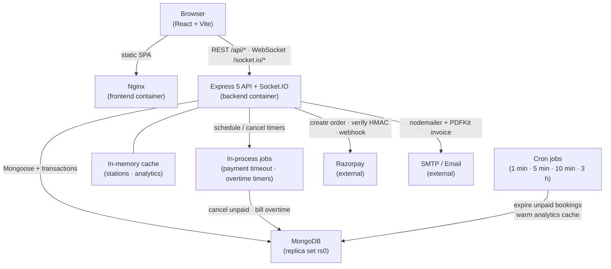
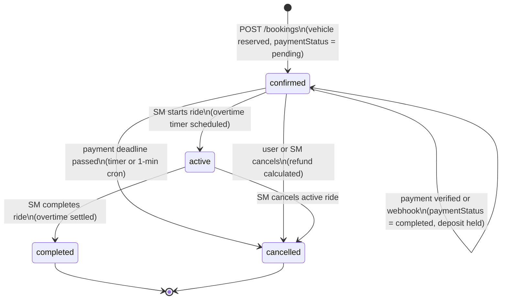
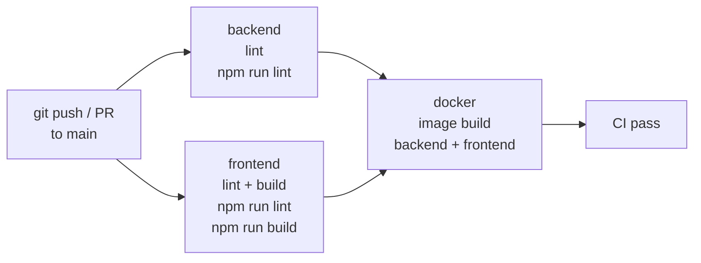

# Architecture — EV-Go

## System architecture



The cache, job timers and Socket.IO rooms all live inside the single backend process. There is no separate cache or message-queue service: the app needs only Node and MongoDB.

In Docker Compose the browser loads the SPA from Nginx on `:5173` and calls the API on `:5000` (`VITE_API_URL=http://localhost:5000` is baked into the build). `nginx.conf` also proxies `/api/` and `/socket.io/` to `backend:5000` for deployments that serve both from one origin.

## Booking state machine



A new booking is `confirmed` with `paymentStatus: 'pending'`. It must be paid within 30 minutes (or 2 hours if the ride starts 12+ hours ahead), otherwise it is cancelled and the vehicle is released.

## CI pipeline



The `docker` job needs both `backend` and `frontend` to pass first (`needs: [backend, frontend]`). It builds images but does **not** push — pushing is a CD concern (see `docs/devops/cd-plan.md`).

## Backend module map

```
backend/
├── server.js          entry point: dotenv, Express app, http.Server, Socket.IO, jobs; --port / --no-jobs options
├── seeder.js          npm run data:import / data:destroy (wipes the DB first)
├── config/
│   └── db.js          MongoDB connection with retry
├── controllers/       one file per domain (auth, booking, payment, refund, stationMaster, superAdmin, …)
├── middleware/        protectRoute, stationMaster, superAdmin, socketAuth, rate limiters
├── models/            Mongoose schemas (User, Station, Vehicle, Booking, Notification, …)
├── routes/            Express routers (mounted in server.js)
├── services/
│   ├── cacheService.js   in-memory Map with TTL; get/set/del/clear
│   ├── queueService.js   setTimeout job timers (payment timeout, overtime); inline email
│   └── invoiceService.js PDFKit invoice
├── jobs/
│   ├── paymentTimeoutWorker.js  processPaymentTimeout()
│   ├── overtimeWorker.js        processOvertimeCheck()
│   ├── emailWorker.js           startup log only
│   ├── paymentTimeout.js        every-minute payment reminder + expiry cron
│   └── cronJobs.js              stuck/unlinked payments, analytics cache warming
└── utils/
    └── logger.js         Winston (colored console dev / JSON+file prod)
```

Booking pricing and validation are inline in `controllers/bookingController.js`.

## Key design decisions

| Decision | Reason |
|---|---|
| MongoDB replica set in Compose | `createBooking` uses multi-document transactions; standalone Mongo rejects `startSession()` |
| Webhook path gets `express.raw()` before `express.json()` | Razorpay HMAC uses the raw request body; `express.json()` would re-encode it |
| `global.io` pattern | Job timers and cron jobs (no `req` context) need to emit Socket.IO events |
| No external cache or job queue | The app runs with only Node and MongoDB. Cache, job timers and Socket.IO rooms are in memory, so it runs as one backend instance |
| Cron as safety net for timers | Timers are lost on restart; the every-minute cron still cancels expired unpaid bookings |
| Bearer token from `localStorage` only (`withCredentials: false`) | Each frontend port keeps its own session, so several roles can be tested at once |
| Single-node replica set (`rs0`) | Full transaction support in Docker Compose with zero operational overhead |
| Non-root Docker user (`evgo`) | CIS Docker benchmark; the container does not run as root |
