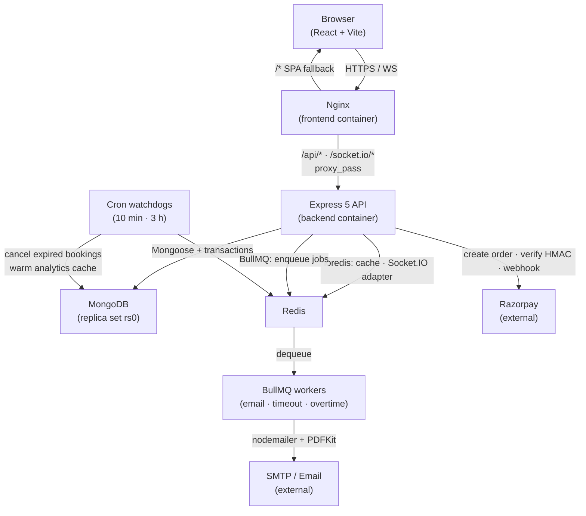
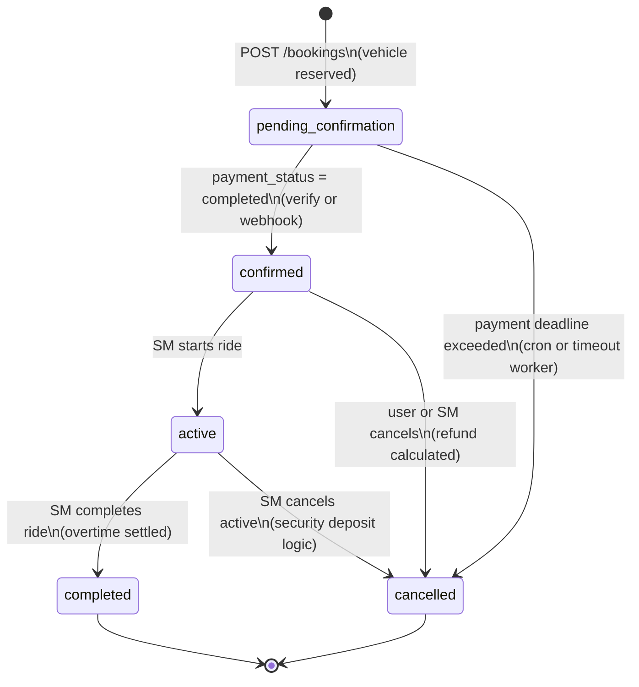
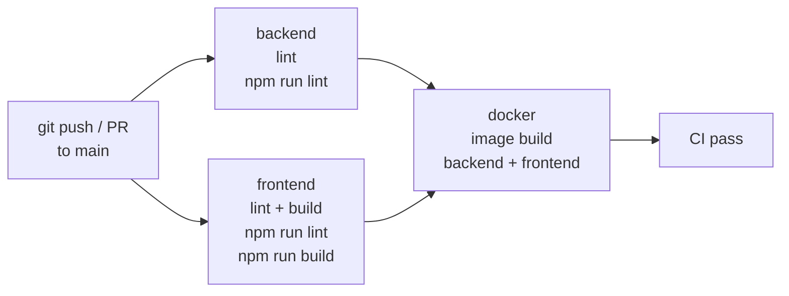

# Architecture — EV-Go

## System architecture



## Booking state machine



## CI pipeline



The `docker` job needs both `backend` and `frontend` to pass first (`needs: [backend, frontend]`). It builds images but does **not** push — pushing is a CD concern (see `docs/devops/cd-plan.md`).

## Backend module map

```
backend/
├── server.js          entry point: Express app, http.Server, Socket.IO, DB/Redis connect
├── config/
│   └── env.js         dotenv load + export validated env vars (imported first in server.js)
├── controllers/       one file per domain (auth, booking, payment, refund, stationMaster, …)
├── middleware/        protectRoute, stationMaster, superAdmin, socketAuth, rateLimiters
├── models/            Mongoose schemas (User, Station, Vehicle, Booking, Notification, …)
├── routes/            Express routers (mounted in server.js)
├── services/
│   ├── cacheService.js   Redis + in-memory Map fallback; get/set/del/invalidatePattern
│   └── queueService.js   BullMQ queues (emails, paymentTimeout, overtime); inline fallback
├── jobs/
│   ├── emailWorker.js
│   ├── paymentTimeoutWorker.js
│   ├── overtimeWorker.js
│   └── cronJobs.js
└── utils/
    ├── logger.js         Winston (colored console dev / JSON+file prod)
    ├── pricingUtils.js   calculateRentalCost, calculateSecurityDeposit, calculateOvertimeRate
    └── bookingValidationUtils.js  validateBookingTimes, calculatePaymentDeadline
```

## Key design decisions

| Decision | Reason |
|---|---|
| MongoDB replica set in Compose | `createBooking` uses multi-document transactions; standalone Mongo rejects `startSession()` |
| Webhook mounted before `express.json()` | Razorpay HMAC uses the raw request body; `express.json()` would re-encode it |
| `global.io` pattern | Workers and cron jobs (no `req` context) need to emit Socket.IO events |
| BullMQ inline fallback | When Redis is unavailable at startup, jobs run synchronously so bookings still function |
| `@socket.io/redis-adapter` | Enables horizontal scaling — any pod can emit to any connected socket |
| Single-node replica set (`rs0`) | Full transaction support in Docker Compose with zero operational overhead |
| Non-root Docker user (`evgo`) | CIS Docker benchmark; image runs with UID 1001, not root |
