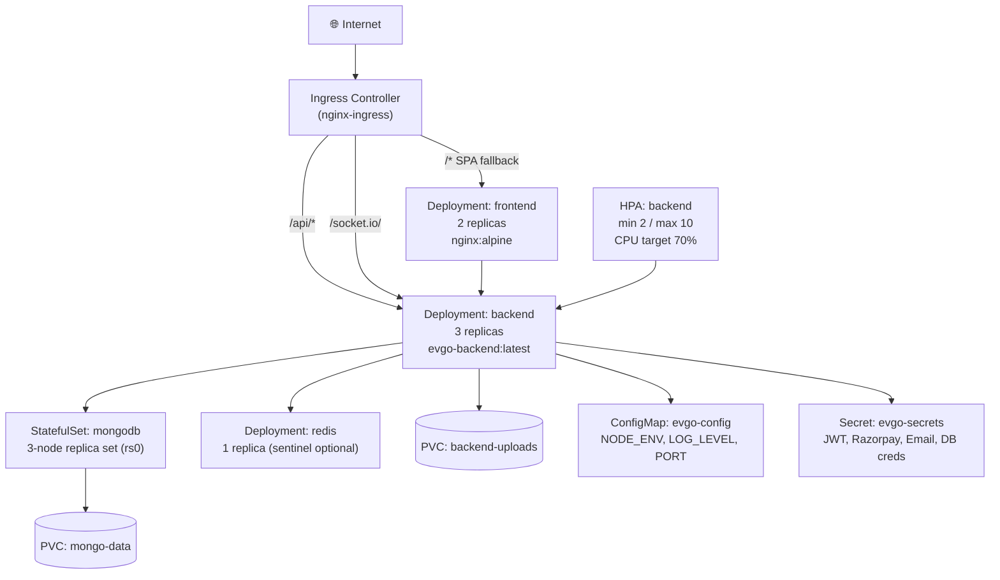

# Kubernetes Plan — EV-Go

> This is a planned architecture. Kubernetes manifests are not part of this repository (per course scope). This document describes how EV-Go would be deployed on Kubernetes if the team chose to move beyond Docker Compose.

---

## Cluster topology



---

## Resource definitions (planned)

### Namespace

```yaml
apiVersion: v1
kind: Namespace
metadata:
  name: evgo
```

### Backend Deployment (excerpt)

```yaml
apiVersion: apps/v1
kind: Deployment
metadata:
  name: backend
  namespace: evgo
spec:
  replicas: 3
  selector:
    matchLabels:
      app: backend
  template:
    spec:
      securityContext:
        runAsNonRoot: true
        runAsUser: 1001
      containers:
        - name: backend
          image: ghcr.io/org/evgo-backend:latest
          ports:
            - containerPort: 5000
          envFrom:
            - configMapRef:
                name: evgo-config
            - secretRef:
                name: evgo-secrets
          livenessProbe:
            httpGet:
              path: /health
              port: 5000
            initialDelaySeconds: 15
            periodSeconds: 30
          readinessProbe:
            httpGet:
              path: /health
              port: 5000
            initialDelaySeconds: 5
            periodSeconds: 10
          resources:
            requests:
              cpu: "250m"
              memory: "256Mi"
            limits:
              cpu: "500m"
              memory: "512Mi"
```

### Horizontal Pod Autoscaler

```yaml
apiVersion: autoscaling/v2
kind: HorizontalPodAutoscaler
metadata:
  name: backend-hpa
  namespace: evgo
spec:
  scaleTargetRef:
    apiVersion: apps/v1
    kind: Deployment
    name: backend
  minReplicas: 2
  maxReplicas: 10
  metrics:
    - type: Resource
      resource:
        name: cpu
        target:
          type: Utilization
          averageUtilization: 70
```

### Ingress

```yaml
apiVersion: networking.k8s.io/v1
kind: Ingress
metadata:
  name: evgo-ingress
  namespace: evgo
  annotations:
    nginx.ingress.kubernetes.io/proxy-read-timeout: "3600"
    nginx.ingress.kubernetes.io/proxy-send-timeout: "3600"
    nginx.ingress.kubernetes.io/configuration-snippet: |
      proxy_set_header Upgrade $http_upgrade;
      proxy_set_header Connection "upgrade";
spec:
  ingressClassName: nginx
  tls:
    - hosts: [evgo.example.com]
      secretName: evgo-tls
  rules:
    - host: evgo.example.com
      http:
        paths:
          - path: /api
            pathType: Prefix
            backend:
              service: { name: backend, port: { number: 5000 } }
          - path: /socket.io
            pathType: Prefix
            backend:
              service: { name: backend, port: { number: 5000 } }
          - path: /
            pathType: Prefix
            backend:
              service: { name: frontend, port: { number: 80 } }
```

---

## Why the Socket.IO adapter matters in Kubernetes

With 3 backend pods, a socket.io `emit` on pod-1 would not reach a client connected to pod-2 without the Redis adapter. The `@socket.io/redis-adapter` configured in `server.js` publishes events to Redis pub/sub, which broadcasts to all pods. This is the reason a Redis deployment is required even when BullMQ is not used.

---

## MongoDB replica set in Kubernetes

The `StatefulSet` with 3 pods (`mongo-0`, `mongo-1`, `mongo-2`) plus a headless Service provides stable DNS names. The replica set is initialised by a post-start hook on `mongo-0`:

```yaml
lifecycle:
  postStart:
    exec:
      command:
        - mongosh
        - "--eval"
        - "try { rs.initiate({_id:'rs0', members:[{_id:0,host:'mongo-0.mongo:27017'},{_id:1,host:'mongo-1.mongo:27017'},{_id:2,host:'mongo-2.mongo:27017'}]}) } catch(e) { print(e) }"
```

Mongoose transactions (`createBooking`) require a replica set; this is why a StatefulSet is used rather than a simple Deployment.
